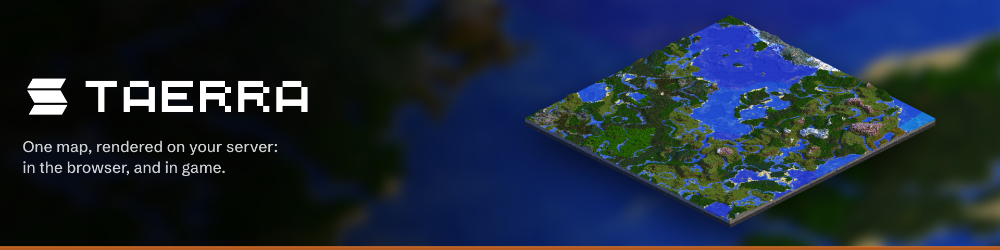

[](https://github.com/aerulion/taerra/actions/workflows/release.yml)
[](https://github.com/aerulion/taerra/actions/workflows/pr.yml)



# TAERRA

One map, rendered on your server: in the browser, and in game.

| Directory      | Part                                                        |
|----------------|-------------------------------------------------------------|
| `plugin/`      | The Paper plugin: renders the tiles, serves the web map     |
| `api/`         | The API other plugins add markers and layers through        |
| `mod/`         | The Fabric mod: map screen and minimap, a viewer only       |
| `tools/mcdata` | Generates `block_data.json` from the vanilla assets         |
| `branding/`    | Renders the logo and store images from the map tiles        |

Rendering happens on the server and nowhere else. The mod draws the tiles the plugin serves and speaks the same HTTP
API as the web map, which is why both live in one repository: a change to that API and every client of it belong in
one commit.

## Prerequisites

* **JDK 25**. With [sdkman](https://sdkman.io), a one-time `sdk env install` in the repo installs the pinned Temurin 25
  from `.sdkmanrc` (with `sdkman_auto_env=true` it switches automatically on every entry into the directory).
* **Python 3**. Only for `tools/mcdata`, see its [README](tools/mcdata/README.md).

## Tasks

``` bash
./gradlew preCommit                  # format everything, then build and test it
./gradlew build                      # compile, test, jar
./gradlew :plugin:test --tests "WebSessionsTest"
./gradlew -q printVersion            # the version this build publishes under
```

**Run `preCommit` before committing.** CI fails on unformatted Java, Kotlin build scripts or JSON. `preCommit` formats
the lot, then runs the full build, so what it leaves behind is what the pipeline will accept.

| Task                         | Purpose                                                        |
|------------------------------|----------------------------------------------------------------|
| `preCommit`                  | Format everything, then build and test                         |
| `:plugin:runDevBundleServer` | Paper in `run/`, with WorldEdit, WorldGuard, Chunky, LuckPerms |
| `:mod:runClient`             | A Minecraft client with the mod loaded                         |
| `runDev`                     | Both at once: offline-mode server, client joins as `TaerraDev` |
| `installGitHooks`            | Point git at `.githooks` (any build does this)                 |

## Versions

Build numbers, not semver. `<build>` is the run number of the release workflow.

```
412-a1b2c3d        release, tagged build-412 (plugin) or mod-412 (mod)
pr57-88-a1b2c3d    snapshot from PR #57
a1b2c3d-dev        local build (-dirty-dev with uncommitted changes)
```

Only a release starts with a number, so PR and local builds always sort below one. `./gradlew -q printVersion` is the
single source of truth; no workflow assembles a version string.

## Releases

Every push to `main` releases whichever parts it changed.

| Touches            | Releases                          | Tags        |
|--------------------|-----------------------------------|-------------|
| anything else      | plugin jar, API → GitHub Packages | `build-<n>` |
| `mod/`             | mod jar                           | `mod-<n>`   |
| shared build files | both                              | both        |

The shared build files are `gradle/`, `build-logic/`, the root build scripts and the wrapper. Markdown and `branding/` are
excluded everywhere. Anything outside `mod/` counts as the plugin, so a new top-level file releases a build rather than silently
not releasing one.

Every release runs the whole Gradle build first, and the API is published in a second step, after every test has
passed. The ten most recent releases per stream and the ten most recent API versions are kept. `manual-cleanup.yml` runs the same cleanup on demand.

## Modrinth

Plugin and mod are one Modrinth project, told apart by loader. Nothing reaches it on its own: run the
**Publish to Modrinth** workflow with a build's tag (`build-<n>` or `mod-<n>`) and a channel, and it uploads that
build's jar with the player-facing changes since the previous Modrinth version, then announces it on Discord. Only the
ten most recent builds per stream still have a release to publish from.

It needs the `MODRINTH_TOKEN` secret, a personal access token with the *Read projects* and *Create versions* scopes
(the project is a draft until approved, so even reading it needs the token).

Publishing a `build-<n>` tag also rebuilds and tests that tag and publishes its API to Maven Central under the same
version. Central versions can never be deleted, so this is the only path there. It needs:

| Secret                                  | Value                                                                  |
|-----------------------------------------|------------------------------------------------------------------------|
| `CENTRAL_USERNAME`, `CENTRAL_PASSWORD`  | A Central Portal user token, from an account that owns `net.aerulion` |
| `SIGNING_KEY`                           | An ASCII-armored PGP secret key whose public key is on a keyserver     |
| `SIGNING_PASSWORD`                      | Its passphrase                                                         |

## Commit messages

`<gitmoji> <type>: <Subject>`. Eleven types, each with exactly one emoji.

```
:sparkles: feat: Add minimap overlay
:bug: fix(tiles): Correct seams between iso tiles
:construction_worker: build!: Drop Java 21 support
```

| Emoji                   | Type       | For                                       |
|-------------------------|------------|-------------------------------------------|
| `:sparkles:`            | `feat`     | a new feature                             |
| `:bug:`                 | `fix`      | a bug fix                                 |
| `:construction_worker:` | `build`    | the build system itself                   |
| `:green_heart:`         | `ci`       | CI configuration and scripts              |
| `:memo:`                | `docs`     | documentation only                        |
| `:recycle:`             | `refactor` | neither fixes a bug nor adds a feature    |
| `:zap:`                 | `perf`     | improves performance                      |
| `:white_check_mark:`    | `test`     | adds or corrects tests                    |
| `:rewind:`              | `revert`   | reverts a previous commit                 |
| `:arrow_up:`            | `deps`     | dependency updates, what dependabot opens |
| `:wrench:`              | `chore`    | anything else                             |

Write the emoji as the shortcode, not the character. A `(scope)` and a `!` for a breaking change are optional, and the
subject starts with a capital letter.

`.githooks/commit-msg` rejects anything else, in the IDE and on the command line alike. Any Gradle build installs it,
so it is enough to have run `./gradlew build` once. Pull requests re-check every commit and the title with the same
script. Merge, revert and fixup messages git writes itself are exempt, as are dependabot's.

These types are also the sections the release notes group by, so a well-formed history writes the changelog.

## Pull requests

Every pull request is validated. Add the `deploy` label and the PR also gets a snapshot, refreshed on every push while
the label is on:

| PR changes | Gets                                                        |
|------------|-------------------------------------------------------------|
| plugin     | `pr<n>-<build>-<commit>` of the API in GitHub Packages      |
| any part   | the plugin and mod jars as workflow artifacts               |

All of it is listed in one comment on the PR. Removing the label or closing the PR deletes the API versions; the jar
artifacts expire on their own.

## API

Released versions are on Maven Central; `pr<n>-…` snapshots and builds not yet on Modrinth are only in GitHub
Packages, which needs authentication. The plugin ships the API, so depend on it `compileOnly`.

``` kotlin
repositories {
  mavenCentral()
}

dependencies {
  compileOnly("net.aerulion", "taerra-api", "412-a1b2c3d")
}
```
